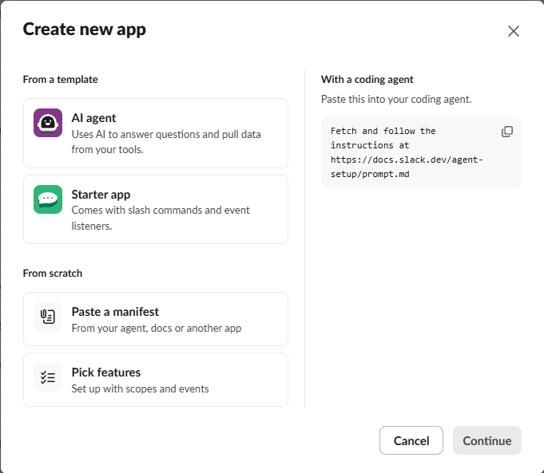
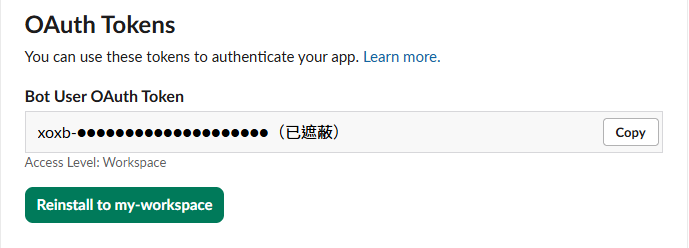
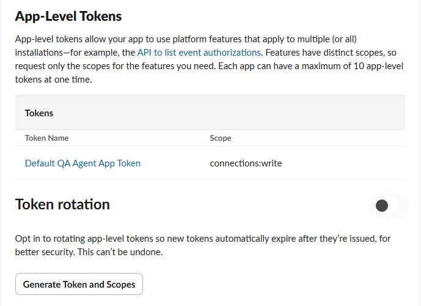

# Slack 與團隊設定

設定分成私人的 `env.sh` 與不含憑證的團隊 JSON；選填 `team.env` 在 env.sh 後載入，同名值以 `team.env` 為準。
JSON 只填 token 的環境變數名稱，不填 token 值。以下為設定索引，完整欄位見 repo 的 `docs-site/agent/configuration.md`。

## 主 App 與角色 App

:::info[「主 App」是哪一個？]

主 App 是管理者用 `deploy/slack-app-manifest.yaml` 建立的那一個 Slack App，**一個專案頻道只有一個**。
內附 manifest 的預設名稱是 `zipe-ai-team`，管理者可能改成別的名稱；本手冊範例裡的 `@zipe-ai-team` 就是主 App。

- 建立需求，以及 `補充 #123`、`中斷 #123`、`取消排隊 #123` 等指令，都是 @主 App。
- 任務的排隊回覆、狀態卡與按鈕都由主 App 發出；討論串裡「已排入中央佇列」那則訊息的發送者就是它。
- `PM Agent`、`QA Agent`、`Backend Agent` 這類名稱是**角色 App**，只用來以角色身分發言或回答直接提問，@它們不會建立工作任務。

名稱由 manifest 的 `display_information.name` 與 `bot_user.display_name` 決定；改名後請告知使用者要 @哪一個。

:::

1. 在 [Slack App 管理介面](https://api.slack.com/apps)按「Create New App」，選「Paste a manifest」，貼上 `deploy/slack-app-manifest.yaml` 的內容建立主 App，再安裝至 workspace。

   

2. 取得兩種 token，分別設定 `SLACK_BOT_TOKEN`、`SLACK_APP_TOKEN`：
   - Bot Token：左側選「OAuth & Permissions」，複製 `xoxb-` 開頭的「Bot User OAuth Token」。

     

   - App-Level Token：左側選「Basic Information」，在「App-Level Tokens」按「Generate Token and Scopes」，加入 `connections:write` 後產生 `xapp-` 開頭的 token。

     

   :::danger

   token 只放進 `env.sh`，**不要截圖、貼到聊天或提交到 repo**。

   :::
3. 每個角色使用 `deploy/agent-manifests/` 對應 manifest 建立並安裝獨立 App，使用自己的兩種 token。
4. 邀請主 App 與已建立的角色 App 進目標頻道（在頻道輸入 `/invite @App名稱`）；安裝到 workspace 不等於已加入頻道。
5. 確認沒有執行中或排隊任務後重啟服務，逐一實際 @角色並驗證流程發言身分。

預設角色的環境變數後綴為 `PM`、`ARCHITECTURE`、`BACKEND`、`QA`、`CODE_REVIEW`。
例如 QA 使用 `SLACK_BOT_TOKEN_QA` 與 `SLACK_APP_TOKEN_QA`。
Bot Token 控制發言身分；App-Level Token 用於 Socket Mode 與直接 mention。缺 Bot Token 退回主 App 代發，缺 App-Level Token 無法直接 @角色。

:::warning

**不要共用主 App 的 App-Level Token。** 只設角色 App-Level Token 卻缺專屬 Bot Token 時，服務會拒絕啟用角色連線。

:::

新增配置式角色時，在角色設定指定 `botTokenEnv`／`appTokenEnv`，建立對應 manifest，完成安裝、token、邀請、重啟與實際驗證；
也可刻意不建獨立 App，但需讓使用者知道由主 App 代發、不能直接 @。

## 必要設定與用途

| 設定 | 說明 |
|---|---|
| `AI_TEAM_ALLOWED_USERS` | 逗號分隔的 Slack member ID，不是顯示名稱 |
| `AI_TEAM_CHANNEL_ID` | 唯一允許操作的頻道 ID，不支援 DM |
| `AI_TEAM_HOME` | 實際安裝目錄 |
| `AI_TEAM_REPO` | 本機目標 repo；配置式專案另由 `repositoryEnv` 指定來源變數 |
| `AI_TEAM_DEFINITION` | 團隊 JSON 的絕對路徑；留空啟用 legacy 模式 |
| `CLAUDE_BIN`／`CODEX_BIN`／`OPENCODE_BIN` | CLI 執行檔絕對路徑；Java 固定要求 Claude，其餘依角色 runtime 檢查；bootstrap preflight 固定要求 Claude 與 Codex，opencode 路徑非空時也檢查 |
| `AI_TEAM_GITHUB_TOKEN` | 發布時推分支與建立 PR；未設定會在發布階段失敗 |
| `AI_TEAM_INSTANCE` | 多服務實例使用不同名稱，避免 systemd unit 衝突 |
| `AI_TEAM_REPORT_DETAIL` | `brief` 或 `full`，預設 brief |

`env.sh` 的完整範本為 `deploy/env.sh.template`。不同團隊的 repo 變數名稱以 `project.repositoryEnv` 為準。

## 配置式團隊的結構

從內附的 `orchestrator/teams/node-web.json` 範例開始，連同其相對引用的 prompts／schemas 一起維護。

| 區塊 | 負責內容 |
|---|---|
| `project` | repo、基準分支、工具鏈、快取、固定操作與獨立驗證指令 |
| `roles` | 角色名稱、runtime、模型、提示、工具權限與 Slack token 變數名稱 |
| `entry`／`nodes` | 起始節點、依賴、路由、角色與輸出契約 |
| `maxTransitions` | 流程轉移上限；與節點重跑、受控交接上限分開 |

`project.operations` 宣告允許的 argv、節點、目錄及寫入範圍；宣告本身不會增加沙箱權限。
`project.verification.commands` 是系統獨立驗證使用的固定指令；agent 不能以自己宣稱測試成功取代收據。
角色可用模型名依 runtime 而異，不可直接互換。

儲存後先驗證：

```bash
java -jar "$HOME/ai-team/orchestrator/target/ai-team-orchestrator-0.1.0.jar" --validate-team "$HOME/ai-team/teams/node-web.json"
```

:::info

這只驗證配置，不代表目標 repo、工具或真實流程已驗收。確認後設定 AI_TEAM_DEFINITION 並重啟，**只有新任務會載入新快照**。

:::
舊任務使用受控遷移或承接，詳見[故障排查](troubleshooting.md)。

## 每個角色各自選 AI CLI 與模型

每個角色在 `roles` 中各自指定使用哪個 AI CLI（`runtime`）與模型，同一團隊可以混用。
以內附範例 `orchestrator/teams/gradle-fullstack.json` 為例（只列相關欄位）：

```json
"roles": {
  "coordinator":    { "name": "PM Agent",             "runtime": "claude-code", "model": "opus" },
  "architect":      { "name": "Architecture Agent",   "runtime": "claude-code", "model": "opus" },
  "builder":        { "name": "Backend Agent",        "runtime": "claude-code", "model": "opus" },
  "tester":         { "name": "QA Agent",             "runtime": "codex", "model": "gpt-5.6-sol", "reasoningEffort": "medium" },
  "inspector":      { "name": "Code Reviewer",        "runtime": "codex" },
  "infrastructure": { "name": "Infrastructure Agent", "runtime": "codex", "model": "gpt-5.6-sol", "reasoningEffort": "medium" },
  "builder_codex":  { "name": "Backend Agent",        "runtime": "codex", "model": "gpt-5.6-sol", "reasoningEffort": "medium" },
  "api_guide":      { "name": "API Guide Agent",      "runtime": "claude-code", "model": "sonnet" }
}
```

完整角色還需要 `prompt`、`tools` 與 token 變數名稱，請從範例檔複製後修改。

### 內附範例各角色使用的 CLI 與模型

三份範例都在 `orchestrator/teams/`。「—」表示該範例沒有這個角色；Code Reviewer 未填 `model`，使用 Codex CLI 的預設模型。

| 角色（負責節點） | `gradle-fullstack.json` | `maven-library.json` | `node-web.json` |
|---|---|---|---|
| PM Agent（intake、triage、service_triage） | claude-code／opus | claude-code／opus | claude-code／opus |
| Architecture Agent（design） | claude-code／opus | claude-code／opus | — |
| Backend Agent（implementation） | claude-code／opus | claude-code／opus | claude-code／opus |
| QA Agent（plan、verification） | codex／gpt-5.6-sol／medium | codex／gpt-5.6-sol／medium | claude-code／sonnet |
| Code Reviewer（review） | codex／CLI 預設 | codex／CLI 預設 | — |
| Security Reviewer（review） | — | — | claude-code／sonnet |
| Frontend Agent（frontend） | — | — | claude-code／sonnet |
| Infrastructure Agent（service、deploy） | codex／gpt-5.6-sol／medium | codex／gpt-5.6-sol／medium | claude-code／sonnet |
| Backend Agent 改派備援（builder_codex） | codex／gpt-5.6-sol／medium | codex／gpt-5.6-sol／medium | — |
| API Guide Agent（只供直接 @ 對話） | claude-code／sonnet | — | — |

範例這樣分配的理由：

- **需求拆解、設計與實作用 Claude Code opus**：這些階段要讀懂需求與程式脈絡並做取捨，選推理較強的模型。
- **QA 與審查改用 Codex**：寫程式和驗收的不是同一個模型，比較不會漏掉同一類盲點。
- **builder_codex 是備援，不是主實作者**：Claude Code 寫不了 `.claude/`、`.mvn`、`gradle/wrapper` 等受保護路徑，
  實作節點的 `protectedPathFallback` 只把這些檔案改派給它，其餘工作仍由 Claude Code 的 Backend 完成。
- **node-web 全部用 Claude Code**：它是功能開關全關的對照範例，不需要額外安裝與登入 Codex；
  較單純的驗收、審查、前端與部署角色用 sonnet，節省額度。
- **API Guide Agent 用 sonnet**：只回答 API 用法問題、不寫檔，不需要最強的模型。

範例中的模型名是撰寫時可用的名稱；你的帳號能用哪些模型、名稱是否改版，以各 CLI 當下支援為準。

### 不同專案用不同的 CLI 與模型

CLI 與模型寫在團隊 JSON 裡，而每個專案各自有一份團隊 JSON，所以**同一個角色在不同專案可以用不同的 CLI 與模型**。
例如專案 A 與專案 B 都有 Backend、QA 與 API Guide 角色，但設定不同：

`<project-a>.json`（實作用 Claude Code、驗收用 Codex）：

```json
"roles": {
  "builder":   { "name": "Backend Agent",   "runtime": "claude-code", "model": "opus" },
  "tester":    { "name": "QA Agent",        "runtime": "codex", "model": "gpt-5.6-sol", "reasoningEffort": "medium" },
  "api_guide": { "name": "API Guide Agent", "runtime": "claude-code", "model": "sonnet" }
}
```

`<project-b>.json`（反過來：實作用 Codex、驗收用 Claude Code，問答角色改用 opencode 接 OpenRouter 的模型）：

```json
"roles": {
  "builder":   { "name": "Backend Agent",   "runtime": "codex", "model": "gpt-5.6-sol", "reasoningEffort": "high" },
  "tester":    { "name": "QA Agent",        "runtime": "claude-code", "model": "sonnet" },
  "api_guide": { "name": "API Guide Agent", "runtime": "opencode", "model": "openrouter/deepseek/deepseek-v4.1-flash" }
}
```

| 角色 | 專案 A | 專案 B |
|---|---|---|
| Backend Agent | claude-code／opus | codex／gpt-5.6-sol／high |
| QA Agent | codex／gpt-5.6-sol／medium | claude-code／sonnet |
| API Guide Agent | claude-code／sonnet | opencode／openrouter/deepseek/deepseek-v4.1-flash |

使用 opencode 時注意：

- 模型名格式是 `provider/model`（例如 `openrouter/deepseek/deepseek-v4.1-flash`），`opus`、`gpt-5.6-sol` 這類名稱在 opencode 無效；名稱錯誤會明確報錯。
- 該實例的 `env.sh` 要設定 `OPENCODE_BIN`，並由本人執行 `opencode auth login` 登入所用的供應商。
  上線前可先用 `opencode run --format json -m <模型> -- "只回覆 OK"` 試呼叫，確認模型名與登入可用。
- opencode 是唯一會回報實際花費金額的 runtime，可用來比較不同模型的成本。

:::warning[opencode 的驗證範圍]

目前只實測過**唯讀的直接 @ 對話角色**（如上例的 API Guide），寫入工作區的流程節點（實作、驗收等）尚未驗證，先不要用在這些角色。

:::

一個服務只載入一個專案配置，所以「多個專案」就是在同一台主機安裝多個服務實例，每個實例各自有：

| 各自一份 | 說明 |
|---|---|
| 安裝目錄 | 用 `install-app.sh` 安裝到不同目錄，各有自己的 `env.sh`、`team.env`、資料庫與工作區 |
| 團隊配置 | `team.env` 的 `AI_TEAM_DEFINITION` 指向該專案的 JSON，角色的 `runtime`／`model` 就在裡面設定 |
| `AI_TEAM_INSTANCE` | 同一台主機有多個實例時必填，且不可重複 |
| 頻道與 Slack App | 每個實例只聽自己的 `AI_TEAM_CHANNEL_ID`，並使用自己的一組主 App 與角色 App，不可共用 token |

:::warning

- 專案自己的配置建議放在實例的 `team-overlay/`，部署時會合併進 `teams/`；**不要直接改線上 `teams/`**，下次部署會被擋下。
- 工具鏈與 CLI 登入可以共用；共用登入時**額度也共用**：A 專案用完 Claude 額度，B 專案使用 Claude 的角色同樣會停在 `WAITING_QUOTA`。
  把較耗額度的專案角色改用另一個 CLI，可以分散壓力。

:::

- 修改某個專案的配置只影響該實例，且只對新任務生效。

| 欄位 | 必填 | 說明 |
|---|---|---|
| `runtime` | 是 | `claude-code`、`codex` 或 `opencode`；對應的 `CLAUDE_BIN`／`CODEX_BIN`／`OPENCODE_BIN` 必須可執行 |
| `model` | 否 | 該 CLI 認得的模型名；留空交給 CLI 預設。三家格式不通用，opencode 為 `provider/model` |
| `reasoningEffort` | 否 | 推理強度 `low`／`medium`／`high`／`xhigh`，目前只支援 `codex`；其他 runtime 填寫會驗證失敗 |

- 各 CLI 的額度分開計算；某個 runtime 用盡時，輪到使用它的角色才會讓任務停在 `WAITING_QUOTA`。
- opencode 目前只實測過唯讀角色對話，寫入工作區的正式階段尚未驗證，正式流程建議先用 Claude Code 或 Codex。
- 名稱打錯時，Claude Code 會直接失敗；**Codex 可能退回預設模型而不報錯**，改完要看實際回報確認。
- 討論串的階段進度訊息會顯示實際使用的角色、runtime、模型與推理強度，例如
  `QA Agent／codex／模型：…／推理：medium`；未指定模型時顯示「CLI 預設」。
- 修改後先用上方 `--validate-team` 驗證，再重啟服務；只有新任務會套用，既有任務沿用建立時的快照。
