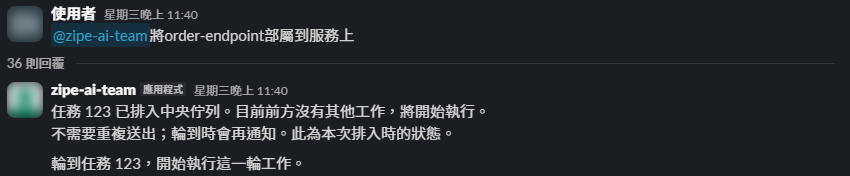

# 安裝與驗證

本頁提供不綁定私人主機的安裝路線；詳細腳本契約以儲存庫 `docs-site/docs/INSTALL.md` 為準。

:::warning

目前尚未完成乾淨 VM 的完整重建驗收，**以下步驟不能視為已驗證的一鍵安裝**。

:::

## 環境與帳號

執行服務使用 Linux、systemd user unit、可用 user bus 與 user namespace。各發行版／架構的證據見 `docs-site/docs/linux-support.md`，未實測不可推定支援。
準備 Java 21、Maven、Node.js、Git，以及 `check-linux.sh`／`preflight.sh` 要求的系統工具。
服務帳號須依 INSTALL 啟用 linger，登出後 user manager 才能持續運作；目前未設定開機自動啟動，重開機後須重新確認服務。
需要 Slack workspace 的 App 安裝權限、目標 Git repo 權限，以及所用 CLI 的有效帳號。
Windows 可用於原始碼與文件開發，不等於已支援 Windows 服務沙箱。

## 請 AI 建置到指定 Server

可以請具備終端機與 SSH 執行能力的 AI 開發工具，依儲存庫的 `AGENTS.md` 與 `docs-site/docs/INSTALL.md`，
將 AI Team 建置、安裝並啟動在指定的 Linux Server（實體機或 VM）。AI 依現有安裝流程操作，驗收仍須逐層留下證據。

請提供 SSH 位址／連接埠／帳號、已核對的主機指紋與金鑰引用、Linux 版本、授權操作範圍、
來源 commit、新安裝路徑、目標專案與團隊／Slack 設定，以及完成條件。
密碼、token 與私鑰透過安全管道設定，在對話中只提供檔案位置或引用。

可直接貼給 AI，替換尖括號欄位：

```text
請依 repo 的 AGENTS.md 與 docs-site/docs/INSTALL.md，
在 <SSH 帳號>@<Server>:<連接埠> 安裝 AI Team。
已核對指紋與金鑰設定：<本機引用位置>；Linux 版本：<版本>。
來源：<repo／commit>；新安裝目錄：<絕對路徑>。
目標專案及團隊／Slack 設定：<配置位置>。
授權範圍：<套件、目錄、服務操作>；保留項目：<資料與既有服務>。
請檢查環境並完成工具鏈、隔離建置、配置、preflight、啟動與驗證。
OAuth／CLI 登入由我本人操作；缺權限時列出具體缺項。
完成後回報版本、checksum、服務狀態、驗證結果與未完成項目。
```

AI 可在授權範圍完成一般安裝與排錯；本人登入、帳號／App 授權與既有真人核准閘門仍需本人完成。
既有安裝應走本頁的升級流程，避免覆蓋資料。安裝 AI Team 本身不需要先有可用的 Slack agent。

## 安裝順序

以下在已準備工具鏈的 Linux 環境執行，`$PWD` 須為完整原始碼根目錄；目的地必須尚不存在。

```bash
bash deploy/bootstrap/check-source.sh
bash deploy/bootstrap/check-linux.sh runtime
bash deploy/bootstrap/install-app.sh "$PWD" "$HOME/ai-team"
```

`install-app.sh` 在暫存來源建置、執行 Maven package，複製 JAR、teams、prompts、schemas 與維運腳本；拒絕覆蓋目的地，完成後不自動啟動。
若還沒準備工具鏈，先依 INSTALL 與 `deploy/bootstrap/toolchain.tsv.example` 提供固定版本、下載來源與官方 checksum，再使用 `provision.sh`。
CLI 版本升級須重驗參數、沙箱與測試網路契約，不直接換 latest。

1. 本人完成 CLI 登入；登入檔與憑證不加入來源包。
2. 建立目標 repo 的完整本機 clone，確保服務帳號可讀取所需分支。
3. 編輯安裝目錄的 `env.sh`，將 `AI_TEAM_HOME` 設為實際安裝目錄，權限設為 600。
4. 依[設定指南](configuration.md)設定主 App、頻道、白名單、repo、CLI 路徑與團隊 JSON。
5. 執行前置檢查後啟動：

```bash
bash "$HOME/ai-team/preflight.sh"
bash "$HOME/ai-team/service.sh" start
bash "$HOME/ai-team/service.sh" status
```

:::warning

- 目前 bootstrap preflight 仍要求 `CLAUDE_BIN` 與 `CODEX_BIN` **都有效**；不要因團隊只用一種 runtime 就省略。
- preflight 只查本機前置，不呼叫模型或 Slack，**不證明** CLI 登入、實際沙箱、訊息送達與 PR 成功。

:::

## 分層驗收

| 層級 | 要確認的證據 |
|---|---|
| 來源與建置 | check-source、Maven 結果、來源版本與 JAR checksum |
| 啟動與隔離 | 服務啟動、自檢、工具鏈與實際沙箱能力 |
| Slack | 白名單真人在目標頻道提問，看到正確回覆；角色逐一測試 |
| 開發流程 | 實際任務完成需求、計畫、實作、驗收與審查 |
| 發布 | 真人核准後建立正確 PR；另行確認合併與產品驗收 |
| 乾淨重建 | 新系統、無沿用暖快取，逐層保存證據；目前未完成 |

:::info

連上 Socket Mode 或程序仍在執行，**不等於端對端驗收通過**。

:::

Slack 層通過時，在目標頻道 @主 App 會在討論串收到任務編號與排隊／開始執行的回覆：



## 升級、備份與復原

先確認沒有執行中與排隊工作，備份資料與配置，在隔離目錄建置後使用既有升級流程。
`deploy/deploy-orchestrator.sh` 與 `deploy/deploy-jar-safe.sh` 用於既有服務升級，新機使用 bootstrap。

:::danger

- 不要在執行中服務的 target 目錄 clean/build。停止被拒時先處理工作，不強制停止來繞過保護。
- **資料庫沒有自動遷移機制**，schema 或快照型別變更前必須規劃相容性與復原。

:::

