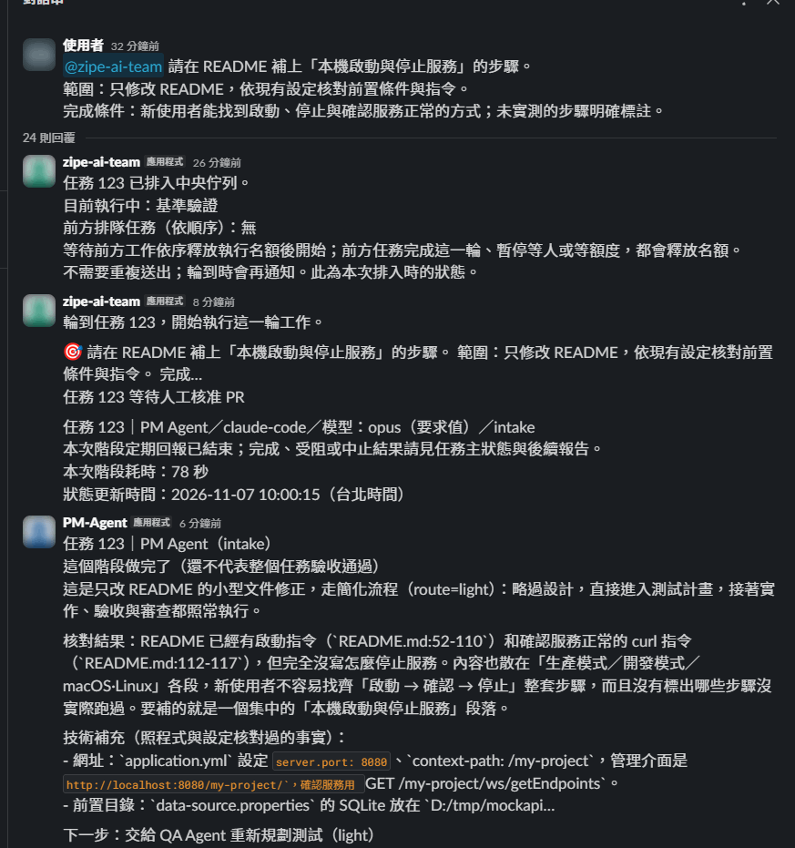
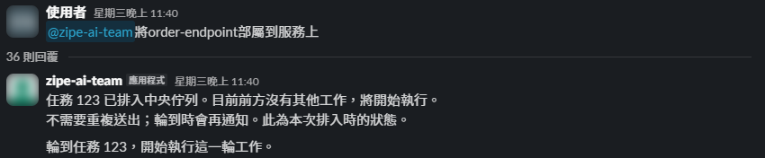
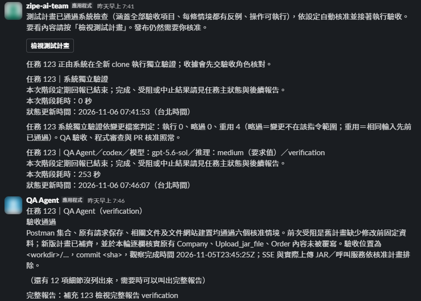
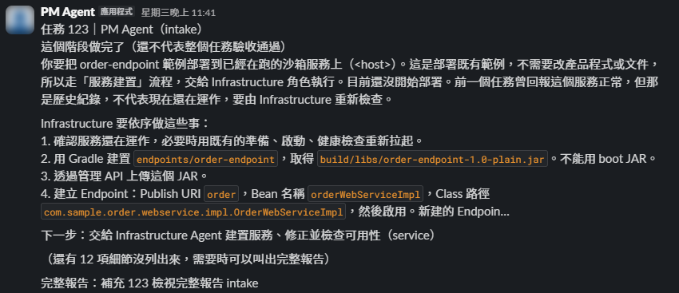
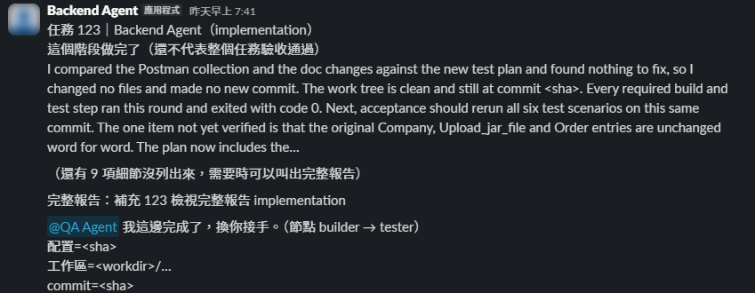
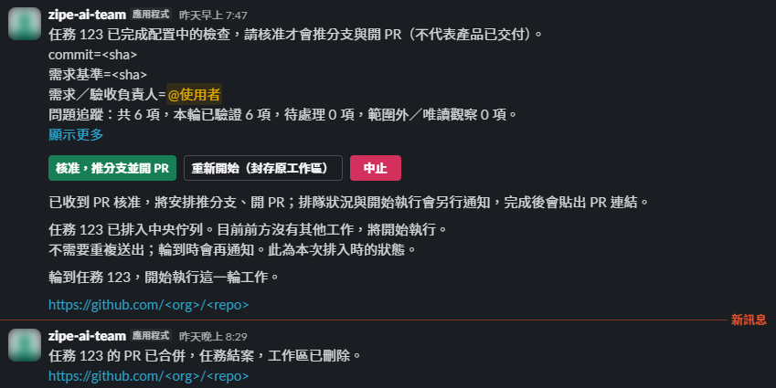

# 第一個 Slack 任務

本頁適合已由管理者完成安裝的使用者。尚未安裝請先讀[安裝與驗證](installation.md)。

## 開始前確認

- 你在 `AI_TEAM_ALLOWED_USERS` 的 Slack member ID 白名單內。
- 你在 `AI_TEAM_CHANNEL_ID` 指定的頻道，主 App 已加入該頻道。
- 服務、CLI 登入與目標 Git 儲存庫都已由管理者驗證。

不支援 DM；一次只 @一個團隊帳號。以下名稱以預設主 App 為例，請在 Slack 選取真正的 mention。

畫面為實際 Slack 截圖，專案名、人名、任務編號、路徑與 commit 已改成通用範例；按鈕與訊息內容以你的團隊配置為準。

## 完整流程示範

下面是一個真實任務的討論串（README 小型文件修改），依序是：建立需求與排隊 → PM 拆解並交給 QA →
QA 寫測試計畫並交給 Backend → 實作與系統獨立驗證 → QA 驗收 → Code Reviewer 審查 → 出現 PR 核准卡。
這次從開始執行到核准卡約 5 分鐘，實際時間依任務大小、排隊與額度而定。



## 1. 在頻道建立需求

在頻道發一則新訊息：

```text
@zipe-ai-team 請替目前專案補齊 README 的本機啟動說明。
範圍：只修改 README，依現有設定核對前置條件與指令。
完成條件：新使用者能找到安裝、啟動、停止與驗證方式；未實測項目明確標註。
```

系統建立任務編號與討論串，回報目前階段或排隊狀態：



後續答案與操作留在原討論串。
每個討論串只綁一個工作任務，即使已結束也不會因再次 @主 App 建立另一個任務；新需求另發新訊息。

## 2. 回答問題與確認計畫

需求不清楚時，PM 會提出問題。使用訊息上的選項或輸入視窗回答；若按鈕不可用，可在原討論串送出：

```text
@zipe-ai-team 補充 #123 請保留既有章節，僅補齊缺少的啟動步驟。
```

`123` 是示意編號，須換成你的任務編號。閱讀測試計畫，確認範圍、驗收方式與限制再核准。
部分團隊允許計畫通過機械檢查後自動核准；是否出現核准卡依配置決定。自動核准時會看到類似訊息，可按「檢視測試計畫」查看內容：



計畫核准不等於 PR 核准。

## 3. 等待實作、驗收與審查

流程由團隊配置決定，典型順序見[工作流程](workflow.md)。文件任務也可能經過 QA，驗證方式應符合修改種類。
排隊訊息會列出前方工作；輪到時再通知開始。不要反覆建立相同需求。

每個角色完成一個階段，會在討論串回報摘要、下一步與「完整報告」指令，並 @下一個角色接手：





## 4. 核准 PR 並確認交付

驗收與審查符合發布條件後，任務提出者可按「核准，推分支並開 PR」。系統重新檢查版本與證據後推送並建立 PR。
`PR_CREATED` 表示 PR 已建立；合併、部署與產品驗收仍需另外處理。



同一張卡上還有「重新開始（封存原工作區）」與「中止」，按下前先確認選的是哪一個。

## 需求怎麼寫比較清楚

提供目標、範圍、完成條件、必須保留的行為，以及可重現的錯誤或相關檔案。需要整批修正時列出完整問題清單與已完成項目。
純詢問會直接回答並結束；若要修改，明說「請修正並驗證」。若只想檢查，明說「只檢查，不修改」。

下一步：[操作與角色對話](usage.md)、[任務停住時怎麼辦](troubleshooting.md)。
