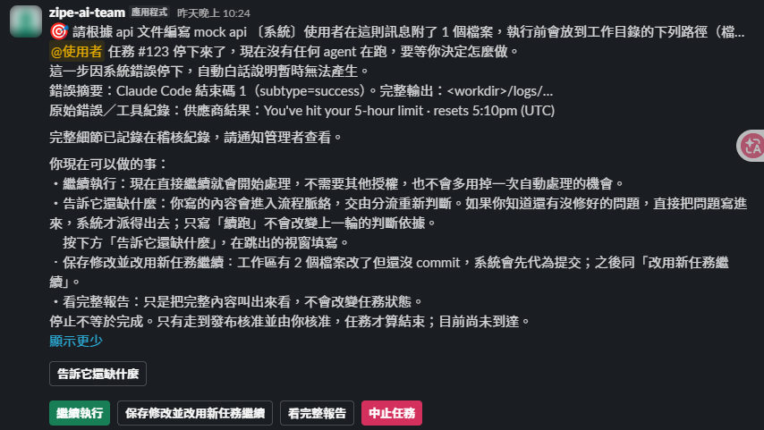

# 任務停住時怎麼辦

先看任務目標、停止原因與可用選項，再決定下一步。可在原討論串送出 `@zipe-ai-team 補充 #123 狀態`。

停住的訊息依序列出任務目標、停止原因（下例是 runtime 額度用盡）、你現在可以做的事與對應按鈕。

:::tip

先讀「錯誤摘要」判斷是額度、登入還是程式問題再選按鈕；**不確定時先按「看完整報告」**，它不會改變任務狀態。

:::

| 現象／狀態 | 意義 | 建議操作 |
|---|---|---|
| `QUEUED`／排隊通知 | 等待中央佇列前方工作；訊息會列出前方任務 | 等「輪到任務…開始執行」通知；不要重開相同需求 |
| `STAGE_RUNNING` | 正在執行流程節點 | 看進度卡；需暫停時用「中斷這一輪」 |
| `AWAIT_HUMAN` | 缺答案、需要決策，或遇到無法自動修復的問題 | 回答具體問題或使用訊息提供的恢復選項 |
| `WAITING_QUOTA` | runtime 額度不足 | 看回報的重試資訊；自動續跑依政策與可用額度，不保證某時間成功 |
| `AWAIT_PR_APPROVAL` | 等任務提出者核准，或發布失敗後等待重試 | 閱讀驗收與審查結果；發布錯誤由管理者修復後再核准 |
| `PUBLISH_RUNNING` | 已收到核准，發布工作已排程 | 仍可能在中央佇列等待，不能視為已推送 |
| `COMPLETED` | 問答、相應流程已結束，或系統確認 PR 已合併後結案 | 核對完成通知與 PR；不能推定已部署或產品驗收通過 |
| `PR_CREATED` | PR 已建立 | 到 GitHub 審閱；不代表已合併或部署 |

啟用 `AI_TEAM_PR_TRACKING`（預設 `on`）時，系統每 10 分鐘追蹤 PR，確認合併後自動結案並刪除工作區。
若 PR 關閉但未合併，任務仍維持 `PR_CREATED` 並停止追蹤，保留 git 工作樹；重新開啟 PR 不會自動恢復追蹤。

## @機器人沒有回應

確認在指定頻道、本人 member ID 在白名單、App 已安裝並邀請進頻道，而且一次只 mention 一個團隊帳號。
角色只能代發時，直接 mention 無法使用。由管理者檢查 Socket Mode 與角色 App-Level Token，不要把 token 貼進聊天。
若服務在接收事件後、持久化前崩潰，訊息可能遺失；管理者確認後才重送。

:::warning[重送前先等一下]

服務停機時送出的 @ 訊息，可能在服務恢復連線後由 Slack 補送並照常建立任務。
**重送前先等幾分鐘**、確認原訊息的討論串沒有出現排隊回覆，否則會建立兩個相同任務。

:::

## 送出重複的需求怎麼取消

:::tip[還在排隊：按「取消排隊」]

由提出者在重複任務的討論串按排隊回覆上的「取消排隊」（或 @主 App 送 `取消排隊 #<編號>`）。
任務會直接中止並移出佇列，**不會啟動任何 agent，也不用額度**。

:::

:::warning[已經開始執行：先中斷再中止]

已輪到並開始執行的任務不能取消排隊：按進度訊息上的「中斷這一輪」，停下後再按「中止任務」。
中斷前已開始的那一段**仍會使用額度**。

:::

## 已更新設定，任務還是照舊跑

任務保存建立當時的團隊快照。重啟與部署不會自動改舊任務；可用受控配置更新，或由負責人選「改用新任務繼續」。
承接保留該任務需求與成果，不會把其他問答發現自動加入範圍；整批問題須明列。

## QA 或審查一直退回

查看具體失敗情境、需求 ID 與證據。實作修改後舊驗證可能失效，必須對新版本重驗。
不要僅為通過而刪除驗收條件；需求確實改變時，由負責人走需求變更核准。
達到流程上限時，選項依可用授權與現場狀態產生，不是每次都能直接續跑。

## CLI 登入、帳號或工具失敗

帳號存取被拒與額度用盡是不同問題。本人處理登入或訂閱存取；管理者核對執行檔、工具鏈、沙箱與網路能力。
修復後沿系統提供的恢復入口重試。

:::danger

**不要直接改資料庫狀態或強制殺服務來跳過檢查。**

:::

驗證層級與環境限制見[安裝與驗證](installation.md)。
