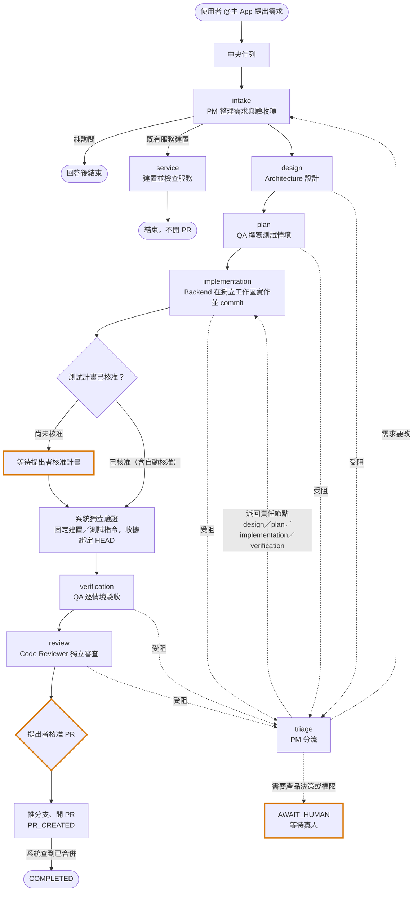
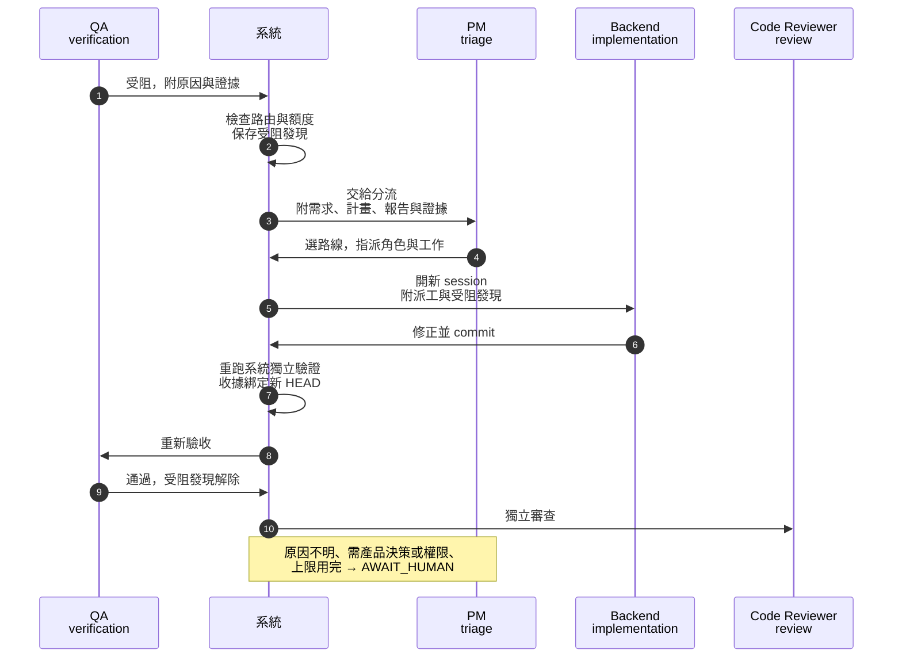
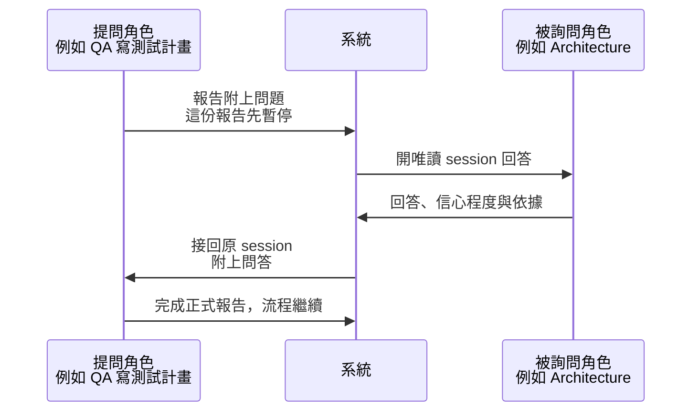

# 工作流程

流程依團隊 JSON 與任務建立時的快照執行。配置式 v2 是現行擴充入口；未指定 AI_TEAM_DEFINITION 的 legacy 模式保留舊任務相容性。

## 典型開發任務

下圖是內附配置的典型路線。實線是正常往下走，虛線是受阻時的自動分流；橘框是需要真人的地方。

| 階段 | 工作與產物 |
|---|---|
| intake | PM 整理需求 ID、原子驗收項、範圍與問題；純詢問可直接回答結束 |
| design | 設計方案與限制 |
| plan | QA 撰寫情境、operation IDs、反例與驗收方式 |
| implementation | 在獨立工作區實作並提交 |
| 計畫核准 | 任務提出者核准；配置允許且機械檢查通過時可自動核准。實作可先進行，**進入驗收前**必須已核准 |
| 系統獨立驗證 | 執行管理者固定指令，產生綁定 HEAD 的收據 |
| verification | QA 依情境逐項驗收，提供證據 |
| review | 獨立程式審查，必要時返工 |
| approval | 真人核准後重新檢查並推分支、開 PR |

這是典型路線，節點名稱與可用路由以團隊配置為準。例如既有服務建置可走 intake → service → end，不經開發 PR 管線。

## 返工與需求變更

驗收失敗交回實作；需求或計畫變更會使相關下游結果失效，不能沿用舊版本通過證據。
受阻時依配置交 PM 分流或真人；agent 不能任意跳到未宣告節點。
新 v2 快照保存共用問題清單，將已登錄問題映射到需求、處理與驗收，完成前檢查漏項；它不能保證模型找出所有缺陷。

## Agent 之間如何自動接手

每個角色完成後交出結構化報告，由系統（不是 agent 自己）檢查格式、證據與路由，再交給下一個節點。
Slack 討論串會看到角色 App @下一個角色，那是可見的交接紀錄；真正決定下一步的是團隊配置與系統檢查。

### 受阻時自動分流與返工

以 QA 驗收受阻為例。分流角色只能選配置裡已宣告的路線；目標節點設有候選角色時，再依角色能力指派負責人，否則由節點的既定角色接手：

- 受阻發現會一路附給下游，直到原節點自己通過才解除；下游不能以「我這裡查不到」當作已解決。
- 防無限循環：相同輸入的節點重跑、整輪換手、自動處理的受阻事件都有上限；有新 commit、新報告或真人補充時才重新計次。
- 修正完成不會直接推送：仍要重跑系統驗證、QA 驗收、審查，最後由提出者核准 PR。

### 工作中互相詢問（選用）

團隊配置啟用 `collaboration` 後，節點可在工作中詢問指定角色。回答者只能唯讀查閱，不能改檔或核准，回答也不能取代驗收證據：

每輪題數、每次節點執行的輪數與每個任務的總題數都有上限，用完後不再提供詢問欄位。

## 核准與完成的意義

:::warning

- 計畫核准、需求變更與 PR 核准限任務提出者。核准收據綁定版本；**計畫核准不等於允許發布**。
- `COMPLETED` 可能是問答、服務流程完成，或系統確認 PR 已合併後結案；**`PR_CREATED` 只表示建立 PR，不代表合併、部署或產品驗收**。

:::

`AI_TEAM_PR_TRACKING` 預設 `on`，系統每 10 分鐘查詢已建立的 PR（啟動後首次也等待 10 分鐘）：
已合併則轉 `COMPLETED` 並刪除工作區；關閉未合併則停止追蹤、保留 git 工作樹，任務維持 `PR_CREATED`。
這項追蹤不會替使用者合併 PR，也不代表部署或產品驗收完成。
關閉開關且未開衝突同步時不再查詢；若 `project.autonomy.pullRequestSyncRounds` 仍大於 0，查到合併仍會結案。

:::info

模型說「已完成」仍須符合系統驗證與發布閘門。

:::

## 長任務、額度與承接

節點重跑、整輪轉移與自動交接有不同上限；超過後只提供目前可用的恢復選項。
額度不足保存現場，依政策排程重試；帳號被拒須另行處理登入／存取問題。
承接新任務從已提交成果接續、採目前配置並重新取得核准；有未提交修改時須使用允許保存修改的承接選項。

repo 開發 session 的跨工具交接依 AGENTS.md 使用結構化摘要，保留目標、限制、版本、證據與下一步。
Slack 任務的接續則由任務快照、收據與工作區管理；兩者不是同一套狀態，也不代表 CLI 原生 compaction 已啟用。

下一步：[第一個任務](quickstart.md)、[停住時的處理](troubleshooting.md)。
